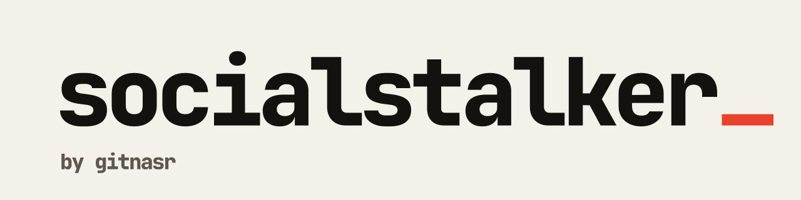

<picture>
  <source media="(prefers-color-scheme: dark)" srcset="assets/banner-dark.svg">
  
</picture>

**Save what you see on Instagram, Facebook and X.** Full-size profile pictures, stories, posts, reels and whole-profile archives, one click from the page you are already on.

<p>
  <a href="https://chromewebstore.google.com/detail/socialstalker-social-medi/hbpaegjojojclojokkjfkbmlenollnpl"><b>Install from Chrome Web Store</b></a> ·
  <a href="https://ss.gitnasr.com">Website</a> ·
  <a href="https://github.com/socialstalker/releases/releases">Releases</a> ·
  <a href="https://github.com/socialstalker/releases/blob/main/CHANGELOG.md">Changelog</a> ·
  <a href="https://ss.gitnasr.com/support">Support</a>
</p>

## What it does

| Platform | You get |
| --- | --- |
| **Instagram** | Full profile picture, posts, carousels, reels, stories, highlights, and a zip of a whole profile |
| **Facebook** | Full profile picture, a zip of uploaded photos, stories |
| **X / Twitter** | The highest-quality video on any post, a zip of an account's own photos and videos |

It also stops sending "seen" receipts when you open a story. Manifest V3, no account, no sign-up.

## How it is built

```
 your browser                        what we run
 ┌──────────────────┐   events   ┌──────────────┐   ┌─────────────────┐
 │ extension (MV3)  │ ─────────▶ │ ingest API   │ ─▶│ worker + storage│
 └──────────────────┘            └──────────────┘   └────────┬────────┘
                                                             │ read-only
                                                    ┌────────▼────────┐
                                                    │ admin dashboard │
                                                    └─────────────────┘
```

| Part | Stack | Where |
| --- | --- | --- |
| `extension` | TypeScript, React, Vite, Manifest V3 | Private source, signed builds in [releases](https://github.com/socialstalker/releases) |
| `backend` | NestJS, Postgres, Redis, BullMQ | Private |
| `dashboard` | Next.js, React, Tailwind | Private |
| `landing` | Next.js, Tailwind | Private, live at [ss.gitnasr.com](https://ss.gitnasr.com) |
| [`releases`](https://github.com/socialstalker/releases) | `.crx` and `.zip` builds, changelog | Public |

Every release is typechecked, tested, signed and published by CI. Nothing is uploaded by hand.

## Install without the store

Grab the latest `.crx` or `.zip` from [releases](https://github.com/socialstalker/releases/releases) and follow the steps in its [README](https://github.com/socialstalker/releases#how-to-install).

## Contact

Bugs and questions: [dev@gitnasr.com](mailto:dev@gitnasr.com) or the [support page](https://ss.gitnasr.com/support).

Made by [gitnasr](https://gitnasr.com). Explained by building.
